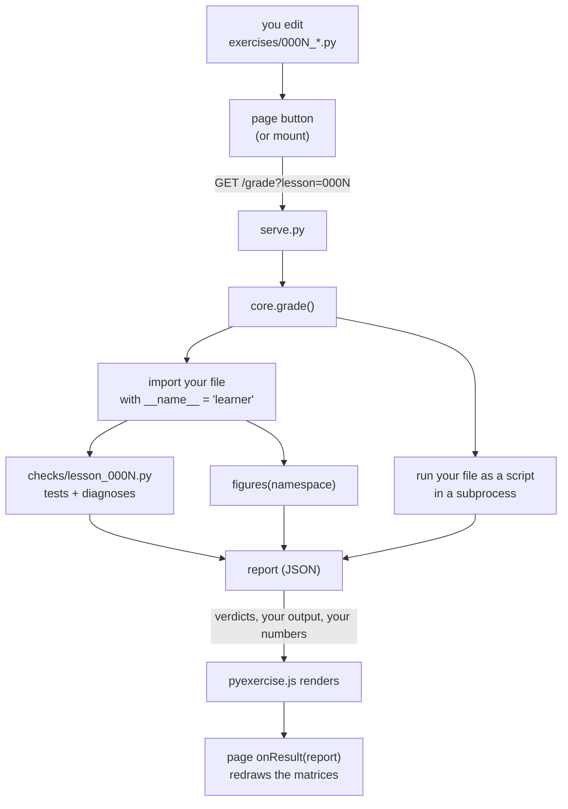

# HOW — how a lesson page in this workspace actually works

Written for two readers: **you**, when you want to know where a number on a page came from or
why a button does what it does, and **any agent editing this workspace**, so the machinery does
not have to be reverse-engineered again.

Everything here is short and boring on purpose: no build step, no framework, no bundler. A page
is one HTML file plus four small scripts. The interesting part — your Python — never lives in
the page at all.

---

## 1 · The pieces

| Path | What it is |
|---|---|
| `lessons/000N-*.html` | one self-contained page: prose, figures, and mounts for the widgets. Loads assets with `<script src>`, nothing else. |
| `exercises/000N_*.py` | **your** implementation. Ships as a stub: signatures, a step list in the docstring, and a `show()` demo at the bottom. |
| `exercises/solutions/000N_*.py` | a reference solution. Never inside `exercises/` itself, so it cannot be read by accident. |
| `tools/grader/core.py` | runs your file, runs the checks, produces the report. The single source of truth for both front ends. |
| `tools/grader/cli.py` | `./bin/grade` — prints the report in the terminal. |
| `tools/grader/serve.py` | `./bin/grader` — serves the workspace over http, answers `/` with the lesson index and `/grade` with the same report as JSON. |
| `tools/grader/checks/lesson_000N.py` | the checks for one lesson: reference implementations, tests, named diagnoses, `figures()`. |
| `tools/grader/checks/support.py` | shared test helpers: `ATOL`, seeded `randn`, `as_tensor`, `shape_of`, `near`, `match_detail`, `max_diff`. |
| `assets/*.js` | shared page components: `matrix-view.js`, `quiz.js`, `pyexercise.js`, `shape.js` (+ lesson 00's own JS harness in `exercise.js` / `tensor.js`). |
| `assets/lesson.css` | the only stylesheet. Light/dark/print are all first-class. |
| `reference/*.html` | one-page sheets you keep: the attention formula, matrix ops, the Python crib, the glossary. |
| `bin/grade`, `bin/grader`, `bin/lesson`, `bin/record` | four bash one-liners that call the venv's Python. |
| `tools/check_lessons.py` | parses every inlined `<script>` and every asset with node/bun, so a stray quote is caught in the terminal instead of in a browser. |
| `tools/record.py` | `./bin/record` — writes the next numbered learning record, creating `learning-records/` first if it is missing. |
| `MISSION.md`, `NOTES.md`, `RESOURCES.md`, `HOW.md`, `README.md` | the teaching context: why the lessons exist, what was decided, what is still open, and how to run the thing. |
| `learning-records/` | what the learner has demonstrably learned. **Gitignored**, so a clone has no such directory until `./bin/record` makes one; nothing else reads or writes it. |

---

## 2 · The loop, end to end



**Your file is executed twice, for two different reasons.** Worth knowing, because it explains
the two halves of the panel:

1. **Imported** (`__name__ = "learner"`) by `core.run_learner_source`. This is what the checks
   run tests against — and because `__name__` is not `"__main__"`, your `if __name__ ==
   "__main__": show()` block does *not* fire here.
2. **Run as a script** (a real subprocess: `.venv/bin/python exercises/000N_*.py`, cwd at the
   workspace root, 20-second timeout). This *does* fire that block, and its stdout/stderr are
   what **"Your file's own output"** shows. So the page prints exactly what your terminal prints —
   including the traceback when your file raises.

Then, still in the same request:

3. Each part's checks run against the imported functions; failures collect test by test, and the
   **first matching diagnosis** from the part's ordered list is attached.
4. `figures(namespace)` calls *your* functions on the page's example tensors and returns their
   numbers as plain lists (so they can cross the JSON boundary).
5. `serve.py` serialises the whole report and the page renders it. The page never re-implements a
   check, and the terminal never re-implements the drawing: **one report, two front ends.**

Endpoints: `GET /` → the lesson index, built from `lessons/*.html` per request (so a new page is
listed without a restart, unlike `/health`); `GET /health` → `{"ok": true, "lessons": [...]}`;
`GET /grade?lesson=000N` → the report. Everything else is served as a static file.
The server binds `127.0.0.1` only, and the report header `Access-Control-Allow-Origin: *` is what
lets a page opened as `file://` (origin `null`) fetch verdicts too.

---

## 3 · What one lesson page contains

The pages follow the same skeleton, so a lesson you read tomorrow looks like the one you read
today:

| Section | Contents |
|---|---|
| header | kicker, `h1`, subtitle, a `lead` paragraph, a `prereq` line linking earlier lessons |
| "the one idea" | the single sentence the lesson is built around |
| §1 … §n | prose, tables, `<div class="formula">`, `<pre><code>` blocks, `<div class="note">` call-outs |
| "Write it" | `<div id="exercise"></div>` — mounted by `PyExercise` |
| "Watch it work" | `<button id="recompute">` + `<div id="watch"></div>` — drawn by the page's own script |
| "The same thing in production" | the real-code version of what you just wrote, quoted verbatim |
| "Check what stuck" | `<div id="quiz"></div>` — mounted by `Quiz` |
| "Do this before you close the tab" | the retrieval instruction |
| sources | a "Primary source · read this next" box, then "Keep for later" links |
| footer | "Ask your teacher" + the link to the next lesson |

The page's inline `<script>` at the bottom does three things:

```js
/* 1. the reference numbers, computed in this workspace, used only when your code
      cannot produce numbers yet — and always labelled as reference when drawn */
var REFERENCE = { /* ... */ };

/* 2. draw(figures): everything under #watch, rebuilt from whatever the report carries */
function draw(figures) { /* MatrixView.heatmap(...) per figure, plus tables */ }

/* 3. mount the two widgets and the button */
var runner = PyExercise.mount(document.getElementById("exercise"), {
  lesson: "0003",
  file: "exercises/0003_multihead.py",
  page: "lessons/0003-several-weighted-averages.html",
  heading: "Your implementation",
  intro: "<p>…the two ways to run your file…</p>",
  onResult: function (report) { draw(report.figures); }
});
document.getElementById("recompute").addEventListener("click", function () { runner.grade(); });
draw(null);                       /* first paint: reference numbers, until a report arrives */
Quiz.mount(document.getElementById("quiz"), { title: "Retrieval practice", items: [ /* … */ ] });
```

**The rule that makes the page honest:** every figure is drawn from *your* numbers when
`figures.<key>.source === "learner"`, and from the page's `REFERENCE` constants otherwise — and
the caption always says which. That is why a caption can read *"computed by **your**
`multi_head_attention()`"* or *"the reference values, because your code cannot produce numbers
yet"*. Never blur those two.

`figures()` returns `{"source": "learner" | "absent" | "error", "values": ..., "error": ...}` per
figure. `"absent"` means the function is not defined; `"error"` carries the exception text the
page shows in a `.console-out` block.

---

## 4 · The checks module contract

`tools/grader/checks/lesson_000N.py` exports `PARTS` and `figures`:

```python
PARTS = [
    {
        "id": "split",
        "title": "Part A — split_heads(x, n_head)",
        "entry": "split_heads",                 # the name looked up in your file
        "missing_hint": "<html>…</html>",       # shown when the function is absent
        "tests": [                              # each test: {"name": …, "run": lambda fn: …}
            {"name": "returns (n_head × T × dh)", "run": lambda fn: _shape_is(fn(x, 3), (3, 5, 2))},
        ],
        "diagnose": [                           # ordered: specific → general, last one always true
            {"when": lambda fn: near(fn(A, B), wrong_answer), "hint": "<html>…</html>"},
            {"when": lambda fn: True, "hint": "the general hint, naming the exact calls"},
        ],
    },
]
```

Rules that are easy to get wrong, each of which cost real time in this workspace:

- **`tests[].run` and `diagnose[].when` must be `lambda`s** (or otherwise late-bound). Writing
  `"run": _shape_is` binds the name at import time, before the helper below it exists →
  `NameError`. The helpers are deliberately defined *below* `PARTS`.
- **Diagnoses must be reachable.** Two ways they silently are not:
  - the probe raises (a transpose on non-square shapes, a wrong arity…) → `_safe` swallows it and
    the diagnostic never fires. Use probes with shapes where a wrong answer still *returns*.
  - the probe compares a value that is `NaN` on both sides (`softmax` over a fully blocked row, or
    any `(-inf) - (-inf)`) → the comparison is meaningless. `support.max_diff` treats identical
    non-finite values as equal precisely so masking remains diagnosable, but a *fully blocked row*
    cannot be compared at all — give that case its own probe with no empty row.
- **Reference implementations must be written independently**, ideally with a different idiom from
  the one the lesson teaches (`checks/lesson_0003.py` splits heads by slicing and `torch.stack`,
  while the lesson teaches `view` + `transpose`). If both sides share a bug, a passing learner
  proves nothing.
- **Each probe needs the right call signature.** `_shape_is_raw(fn, shape, args)` exists because
  every part's function takes different arguments; a probe that calls a 1-argument function with 4
  arguments just returns "no match".
- **Tolerance** is `support.ATOL = 1e-5` — float32 chains land within ~4e-8 of float64, so this is
  seven orders of slack for correct code and seven orders tighter than any real mistake. Exact
  comparisons are used only where the property is genuinely exact (`weight == 0.0` for blocked
  cells, `torch.equal` for the leak test and the split/merge round trip).
- **Permanent tests must catch plausible bugs**, not wiring: no "the function exists", no "the
  shape is non-empty". Behaviour, boundaries, invariants (rows sum to 1, heads don't mix, the
  future can't leak), and error cases.

---

## 5 · The report

Both front ends consume this one structure (`./bin/grade 000N --json` prints it):

| Field | Meaning |
|---|---|
| `lesson`, `title`, `source` | which lesson, and which file was actually graded |
| `error` | `null`, or `{kind: "missing" \| "syntax" \| "runtime", message, line, text}` — your file never loaded |
| `parts[]` | per part: `id`, `title`, `passed`, `verdict`, `tests[]{name, ok, detail}`, `diagnosis`, `raised` |
| `figures` | whatever `checks.figures(namespace)` returned — the page's grids |
| `output` | `{stdout, stderr, returncode, timed_out, truncated}` — your file run as a script, which is what the panel's "Your file's own output" block shows (the CLI prints the same block, and skips it when the file printed nothing). |

Diagnosis hints are authored **once**, as HTML in the checks module, and the CLI strips tags with
`cli.plain`, so the page can use emphasis and the terminal still reads cleanly.

---

## 6 · Adding a lesson (the checklist that works)

1. `exercises/000N_*.py` — the stub: signatures, step list, `show()` demo, `EXAMPLE_*` tensors.
   **Back it up** (`cp exercises/000N_*.py /tmp/stub_000N.py`) before you ever overwrite it.
2. `exercises/solutions/000N_*.py` — a reference solution, short, commented at the key lines.
3. `tools/grader/checks/lesson_000N.py` — `PARTS` + `figures`, references written a second way.
4. `tools/grader/core.py` → `LESSONS["000N"] = {"title", "source", "checks", "solution"}`.
5. `lessons/000N-*.html` — the page, reusing the shared components (never re-implement a widget).
6. If a new visual idiom is needed, add it to `assets/lesson.css` (e.g. the `.h0`–`.h3` head
   bands, `.masked`, `.self`), keeping theme variables rather than literal colours.
7. Restart `./bin/grader` — the registry is read at import time.
8. Verify, in this order:
   `./bin/grade 000N --file exercises/solutions/000N_*.py` (must pass) ·
   `./bin/grade 000N` (the shipped stub must fail with `NotImplementedError`, not crash) ·
   a **variant suite**: one file per plausible mistake, asserting the intended diagnosis fires ·
   the filled stub, run directly, for the demo output · `./.venv/bin/python tools/check_lessons.py` ·
   a Chromium pass over stub → filled → stub, plus the quiz answered by clicking · then restore the
   stub and confirm with `grep -c NotImplementedError`.
9. Update `reference/glossary.html` (new terms), the relevant sheet, `NOTES.md` (open threads),
   `RESOURCES.md` (workspace material + any new gap).

---

## 7 · Traps, all of which have bitten

- **`tab.run(... page.evaluate ...)` runs in an isolated world.** Page globals (`PyExercise`,
  `Quiz`) are `undefined` there and expando properties set by page code do not read back. Drive the
  DOM instead: `#exercise .pyex-part`, `.feedback`, `.tests li`, `.pyex-demo`, `button.click()`,
  `input.value`. DOM events *do* cross the boundary, so clicking works.
- **The stub is the shipped artefact and exists nowhere else.** Copying `solutions/` over
  `exercises/` to test the passing state is fine — restoring it from memory is not. (Done twice
  here; the file is byte-identical when restored, but it is pure risk.)
- **The service imports the registry once.** Add a lesson and `/health` will still list the old set
  until you restart `./bin/grader`.
- **`file://` + no service is a supported state**, not a crash: the panel shows the two recovery
  commands instead of pretending to check anything. Test that path by opening the file directly
  with the service stopped.
- **Judge nothing by reading the page's HTML alone.** `tools/check_lessons.py` catches syntax; only
  a browser catches a wrong selector, a mislabelled caption, or a chart drawn from the wrong array.
- **Nothing in the grading path may depend on a directory that is gitignored.** `learning-records/`
  is untracked, so a fresh clone does not have it: the grader, the server, the CLI and
  `tools/check_lessons.py` never read it, and the one script that writes it (`./bin/record`) does
  `mkdir -p` before it scans for the next number. Test that state by moving the directory aside,
  running the loop, and moving it back (`./bin/record --list` should still be the last check).
- **Answer positions in a quiz must vary.** A page whose correct option is always `A` leaks the
  answer through formatting — the same reason options are written to equal length.

---

## 8 · Trust boundary

- The service binds `127.0.0.1`; it is not reachable from the network.
- The only code ever executed is the file the **lesson registry** names under `exercises/`
  (or the explicit `--file` you pass on the command line). Nothing supplied over the network is
  executed, ever — the query string selects a lesson id, and an unknown id returns an error.
- The subprocess has a 20-second timeout and truncated output, so a runaway demo cannot wedge the
  page or the terminal.
- Solutions live outside `exercises/`, so the page can point at `./bin/grade 000N --show-solution`
  without putting the answer next to your file.
